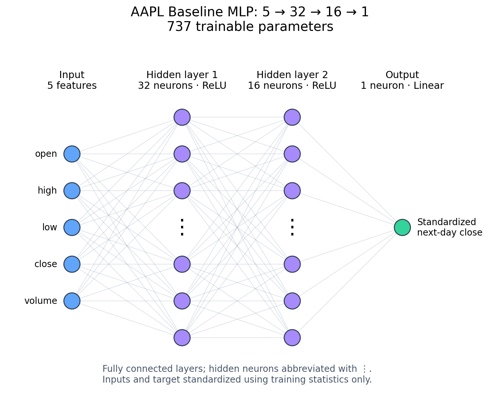
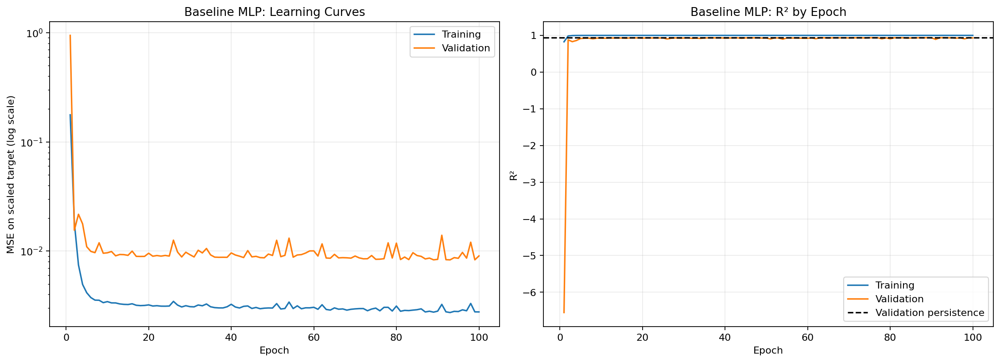
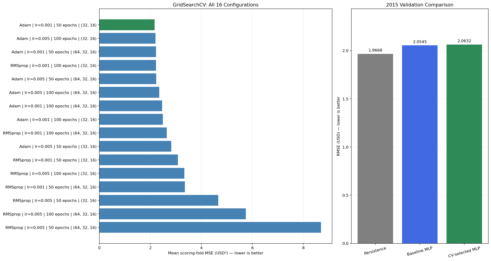
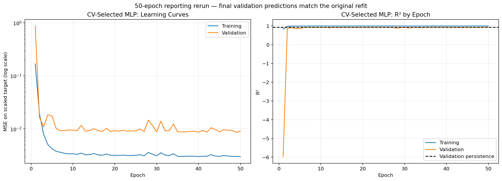
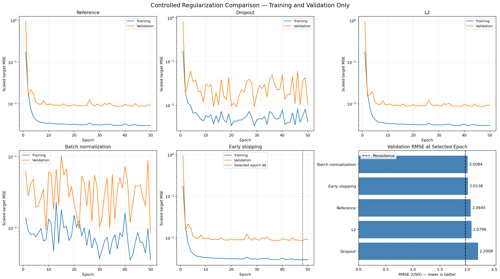
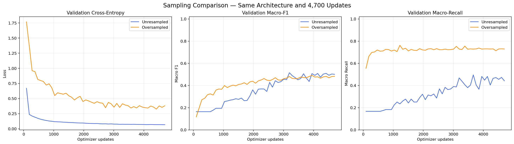
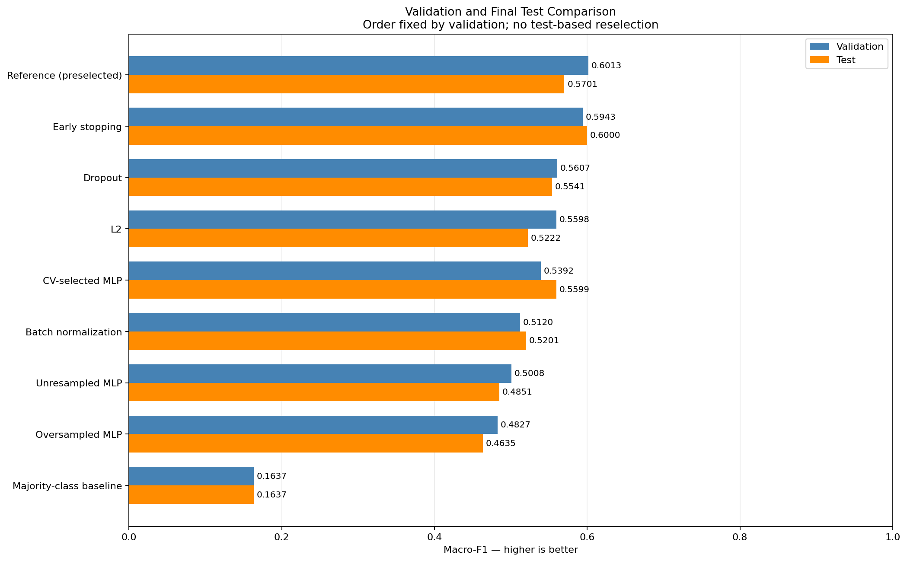

# Deep Learning Lab 1

**Master MBD | FST Tanger | Pr. Elaachak Lotfi**

PyTorch DNN/MLP experiments for regression and multiclass classification.

**Status:** Both parts have saved final test results. Classification tuning (#9) is complete; #10 awaits per-class training exports. Final reproducibility and synthesis review (#11–#12) remain.

## Datasets and tasks

| Part | Dataset | Planned task |
|---|---|---|
| Regression | [NYSE](https://www.kaggle.com/datasets/dgawlik/nyse) | Predict a selected stock's next-day closing price using information available through today |
| Classification | [Predictive maintenance](https://www.kaggle.com/datasets/shivamb/machine-predictive-maintenance-classification) | Predict the multiclass failure type |

Record exact filenames, stock/date coverage, targets, features, and class labels in the notebooks. Dataset files are not committed.

## Notebooks

- [Regression](notebooks/01_regression.ipynb)
- [Classification](notebooks/02_classification.ipynb)

Each notebook is intended to run independently from top to bottom. Part 1 has saved outputs through final evaluation. Part 2 has saved outputs through tuning, regularization, and frozen test evaluation.

## Setup and execution

1. Import the appropriate notebook into Kaggle and attach its dataset.
2. Use the versions recorded in [requirements.txt](requirements.txt). The exported notebooks currently install skorch and imbalanced-learn without pins; compare their printed versions with this file when rerunning.
3. Configure dataset paths, seeds, and GPU/CPU device selection.
4. After implementation, run each notebook from a fresh session with **Run All**.

Kaggle notebook links and measured runtime: _to add_.

Verified setup: Python 3.13.15, Tesla T4, PyTorch 2.11.0+cu128, seed 42, and automatic CPU fallback. The regression CSV has 851,264 rows and 7 columns; the maintenance CSV has 10,000 rows, 10 columns, and six failure-type classes. These are setup checks, not model evaluation results. Notebook code was executed in Kaggle; local review inspected saved code and outputs only.

## Evaluation plan

- Regression: chronological partitions, time-aware CV, persistence baseline, MAE/RMSE/R². Use R²/epoch in place of classification accuracy and explain the substitution.
- Classification: stratified partitions, training-only balancing, accuracy, macro/per-class recall and F1, class support, and confusion matrices.
- Fit preprocessing and resampling only within training partitions, including CV folds.
- Use sklearn GridSearchCV with skorch. Select models using validation/CV only.
- Freeze model configurations before producing the required final train/test curves and metrics.
- Compare regularization variants with controlled settings.

## Roadmap

See [the roadmap](ROADMAP.md), [issues](https://github.com/soulaimane-22/Deep-Learning-Lab1/issues), and [milestones](https://github.com/soulaimane-22/Deep-Learning-Lab1/milestones).

## Results

_To complete after experiments. Export small result tables and search configurations to `reports/results/` and plots to `assets/plots/`._

## Synthesis

[Personal synthesis](reports/synthesis.md) — to complete after the experiments.

## Regression EDA

AAPL has 1,762 observations spanning 2010–2016, with no missing observed trading dates or zero-volume rows. The next-day prediction setup yields 1,257 training samples (2010–2014), 251 validation samples (2015), and 251 test samples (2016). Two boundary-crossing examples are excluded. Saved assertions verify disjoint partitions and target alignment.

Training-only analysis shows strongly correlated OHLC prices, right-skewed volume, and occasional large daily price changes. Extreme observations are retained. Scaling must be fitted on training data, and the future MLP will be compared with persistence. Correlation alone does not establish forecasting performance.

Additional plots: [distributions and boxplots](assets/plots/aapl_training_distributions_boxplots.png), [correlations](assets/plots/aapl_training_correlations.png), and [next-day changes](assets/plots/aapl_training_next_day_changes.png).

Split records: [dates and counts](reports/results/aapl_split_summary.csv), [excluded examples](reports/results/aapl_excluded_boundary_rows.csv), and [export provenance](reports/results/README.md).

## Baseline regression

The 5–32–16–1 ReLU MLP (737 parameters) uses training-only input/target standardization, Adam (learning rate 0.001), batch size 32, and 100 fixed epochs. Metrics below use original USD price units. At the baseline stage, the test set had not been evaluated; final results are reported below.

| Model | Partition | MAE | RMSE | R² |
|---|---|---:|---:|---:|
| Persistence | Training | 0.790716 | 1.135872 | 0.997240 |
| Persistence | Validation | 1.497729 | 1.966823 | 0.933962 |
| MLP, epoch 100 | Training | 0.807170 | 1.137929 | 0.997230 |
| MLP, epoch 100 | Validation | 1.607750 | 2.054546 | 0.927940 |

The MLP does not beat persistence: validation MAE is about 7.3% higher and RMSE 4.5% higher. Learning improves rapidly initially, then validation loss plateaus with fluctuations. These curves alone do not establish progressive overfitting.

Saved evidence: [configuration](reports/results/aapl_baseline_config.json), [100-epoch history](reports/results/aapl_baseline_training_history.csv), [comparison](reports/results/aapl_baseline_comparison.csv), and [validation predictions](reports/results/aapl_baseline_validation_predictions.csv).

## Regression hyperparameter tuning

GridSearchCV compared 16 configurations across three expanding chronological folds within 2010–2014 (48 fits plus one refit). Each scoring fold has 200 samples, with a one-row gap. Input and target scaling are fitted within each fold; target-shape checks prevent loss broadcasting. Selection uses mean CV MSE in original USD² units.

Selected: Adam, learning rate 0.001, hidden layers (32, 16), batch size 32, and 50 epochs. Mean CV MSE is 2.163347 USD². This is the best configuration in the tested grid, not a guarantee of better future performance.

| Model | 2015 validation MAE | RMSE | R² |
|---|---:|---:|---:|
| Persistence | 1.497729 | 1.966823 | 0.933962 |
| Original MLP | 1.607750 | 2.054546 | 0.927940 |
| CV-selected MLP | 1.615260 | 2.063188 | 0.927332 |

The selected model does not improve on the original baseline in 2015, and persistence remains strongest. The 2016 test set was reserved until the final evaluation reported below. A fixed reporting rerun reproduced the selected model's validation predictions exactly and supplied the learning curves without checkpoint selection.

Saved evidence: [configuration](reports/results/aapl_gridsearch_config.json), [fold boundaries](reports/results/aapl_gridsearch_folds.csv), [full CV results](reports/results/aapl_gridsearch_cv_results.csv), [ranking](reports/results/aapl_gridsearch_ranking.csv), [comparison](reports/results/aapl_tuning_comparison.csv), [validation predictions](reports/results/aapl_tuned_validation_predictions.csv), and [reporting history](reports/results/aapl_tuned_reporting_history.csv).

## Regularization and final test evaluation

Five variants used the same training partition, training-fitted scalers, seed, Adam learning rate 0.001, batch size 32, and maximum 50 epochs. Dropout used probability 0.1; explicit L2 used coefficient 0.0001 on linear weights only. Batch normalization added 96 trainable parameters. Early stopping reached 50 epochs and restored epoch 48; it did not save training epochs in this run.

Batch normalization was selected among the regularization variants using 2015 validation RMSE (2.008407 USD), while persistence was the preferred overall method (1.966823 USD). These choices were frozen before evaluating 2016. Test results did not change the selected model or epoch.

| Model | Test MAE (USD) | Test RMSE (USD) | Test R² |
|---|---:|---:|---:|
| Persistence | 1.047450 | 1.500136 | 0.961452 |
| Original MLP (100 epochs) | 1.092752 | 1.514151 | 0.960728 |
| CV-selected MLP | 1.131629 | 1.556521 | 0.958499 |
| Reference | 1.116967 | 1.561191 | 0.958250 |
| Dropout | 1.304080 | 1.718157 | 0.949433 |
| L2 | 1.134871 | 1.579619 | 0.957258 |
| Batch normalization | 1.074130 | 1.515713 | 0.960647 |
| Early stopping | 1.053585 | 1.502869 | 0.961311 |

Persistence remained best on the test set. Early stopping was close, but was not selected retrospectively using test results. None of the tested neural networks beat persistence. These findings are limited to AAPL, one temporal split, one seed, and the tested configurations.

Reference and L2 losses stabilized after initial improvement; dropout and batch normalization fluctuated more. Train/test curves use plain MSE in USD², excluding regularization penalties, and R² in place of classification accuracy. Test epoch curves were produced from saved checkpoints for reporting only, with selected checkpoints restored afterward.

Evidence: [frozen plan](reports/results/aapl_regularization_frozen_plan.json), [validation comparison](reports/results/aapl_regularization_comparison.csv), [final test metrics](reports/results/aapl_final_test_metrics.csv), [test predictions](reports/results/aapl_final_test_predictions.csv), and [test epoch history](reports/results/aapl_regularization_test_epoch_history.csv).

## Classification baseline and oversampling

The six-class maintenance task uses stratified training/validation/test partitions of 6,000/2,000/2,000 records (seed 42). UDI, Product ID, and binary Target are excluded. The 27 binary/multiclass label disagreements are documented; supplied multiclass labels are retained. Training-only scaling and one-hot encoding produce eight inputs. Random Failures has only 11 training and three validation observations.

Both MLPs use an 8–32–16–6 ReLU architecture (918 parameters), unweighted cross-entropy, Adam at 0.001, batch size 64, and 4,700 optimizer updates. Random oversampling repeats training observations to 5,792 per class (34,752 total). Final-batch sizes differ between loaders. Training metrics use the original 6,000 rows; validation retains its original distribution. Both runs retain their final weights without checkpoint selection.

| Model | Validation accuracy | Macro-recall | Macro-F1 |
|---|---:|---:|---:|
| Majority class | 0.965000 | 0.166667 | 0.163698 |
| Unresampled MLP | 0.980000 | 0.442047 | 0.500755 |
| Oversampled MLP | 0.878500 | 0.729026 | 0.482743 |

Oversampling improves recall for four failure classes but increases false alarms from 2 to 233 among 1,930 No Failure records. Tool Wear recall rises to 7/9 with precision only 6.48%; Random Failures remains undetected (0/3). The unresampled model is preferred by the primary validation macro-F1 criterion. These are single-seed comparisons with small minority supports. At the oversampling comparison stage, classification test data had not yet been evaluated. Future CV must fit preprocessing and any resampling within each training fold.

Evidence: [comparison](reports/results/maintenance_sampling_comparison.csv), [baseline configuration](reports/results/maintenance_baseline_config.json), [oversampling configuration](reports/results/maintenance_oversampling_config.json), [baseline confusion matrix](assets/plots/maintenance_baseline_validation_confusion.png), and [oversampled confusion matrix](assets/plots/maintenance_oversampled_validation_confusion.png).

## Classification tuning and final evaluation

A three-fold GridSearchCV compared 16 unresampled configurations (48 fits), fitting preprocessing within each training fold. Adam at 0.005, hidden layers (32, 16), batch size 64, and 100 epochs achieved mean CV macro-F1 0.536721 and validation macro-F1 0.539219. A reporting rerun reproduced validation probabilities exactly.

Five controlled variants used these settings. Reference led on validation macro-F1 (0.601341), ahead of early stopping (0.594252), and its epoch-100 checkpoint was frozen before test evaluation. Early stopping ran 61 epochs and restored epoch 46. The manual Reference and earlier skorch refit use different training loops and are distinct runs; Reference is the direct control for regularization.

| Model | Test accuracy | Test macro-recall | Test macro-F1 |
|---|---:|---:|---:|
| Reference (preselected) | 0.984500 | 0.531390 | 0.570124 |
| Early stopping | 0.987000 | 0.594551 | 0.599975 |
| Dropout | 0.983000 | 0.509274 | 0.554148 |
| L2 | 0.980000 | 0.504719 | 0.522181 |
| CV-selected MLP | 0.980000 | 0.589916 | 0.559920 |
| Batch normalization | 0.981500 | 0.464241 | 0.520147 |
| Unresampled MLP | 0.978000 | 0.419149 | 0.485091 |
| Oversampled MLP | 0.869500 | 0.664160 | 0.463491 |
| Majority baseline | 0.965000 | 0.166667 | 0.163698 |

Early stopping achieved the highest observed test macro-F1, without changing the validation-based selection. Reference detected 18/22 Heat Dissipation, 11/16 Overstrain, and 13/19 Power failures, with three false alarms among 1,930 No Failure rows. It missed all four Random and nine Tool Wear failures. High accuracy therefore masks important limitations; minority supports are small and results use one seed and split.

Training loss fell while held-out loss increased later for Reference and batch normalization, consistent with overfitting. Epoch fluctuations are expected with mini-batch optimization. All 461 saved checkpoint evaluations were reporting-only; selected checkpoints were restored afterward.

Evidence: [search configuration](reports/results/maintenance_gridsearch_config.json), [frozen plan](reports/results/maintenance_regularization_frozen_plan.json), [test metrics](reports/results/maintenance_final_test_metrics.csv), [test reports](reports/results/maintenance_final_test_classification_reports.csv), and [epoch curves](assets/plots/maintenance_regularization_train_test_curves.png).
