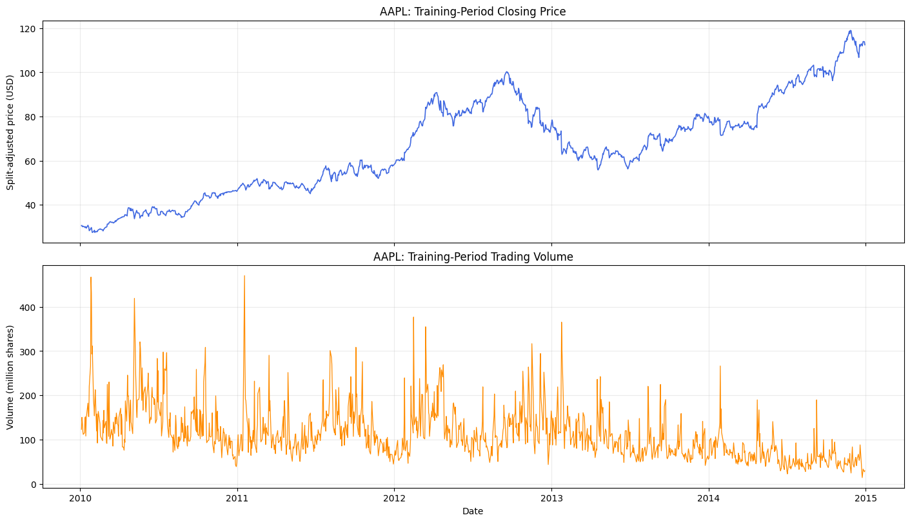
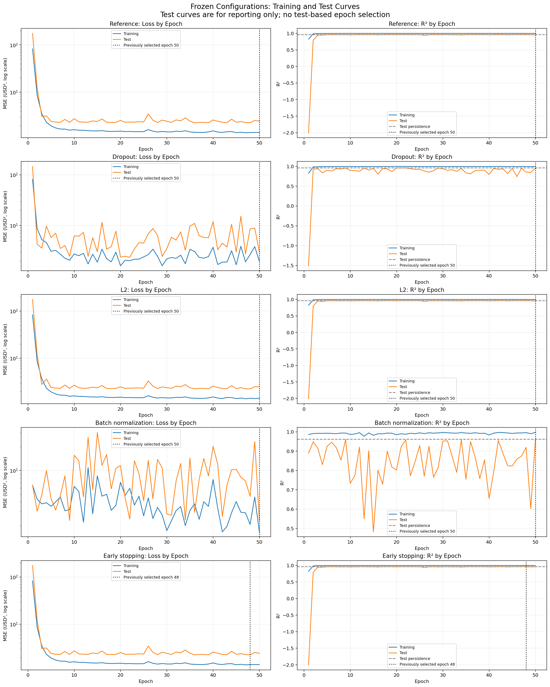
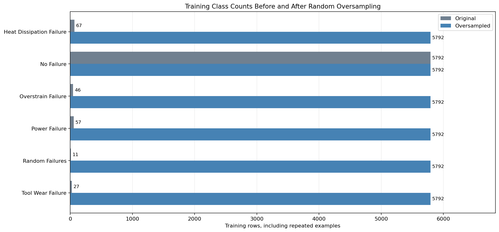
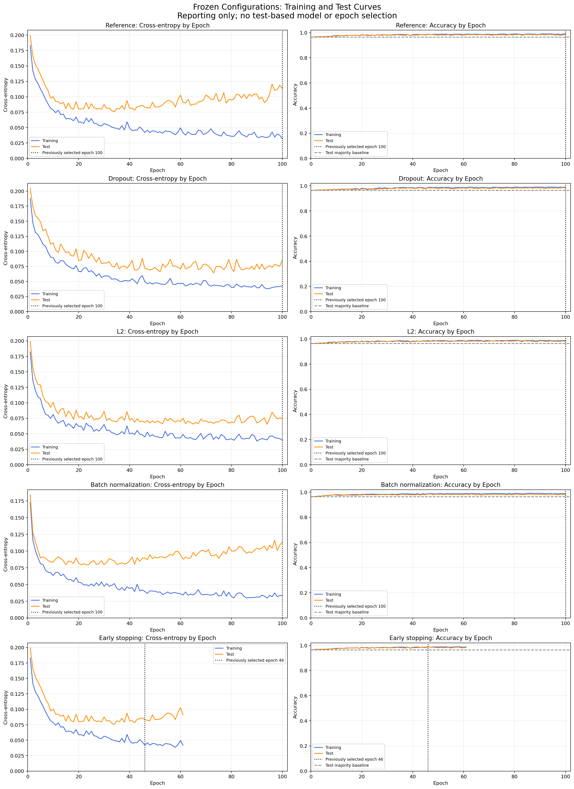
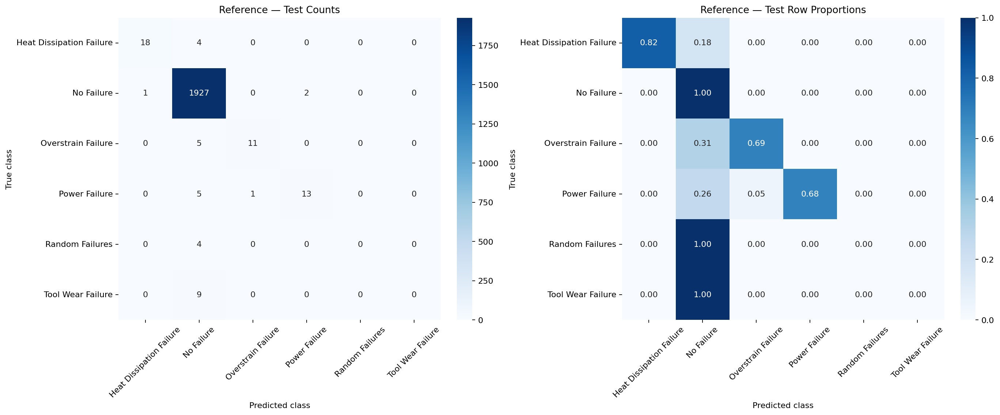

# Deep Learning Lab 1

This lab uses PyTorch multilayer perceptrons (MLPs) for stock-price regression and multiclass machine-failure classification. It compares baseline models, hyperparameter tuning, and regularization.

The complete code and outputs are in [the regression notebook](notebooks/01_regression.ipynb) and [the classification notebook](notebooks/02_classification.ipynb). Experiments were run in Kaggle with seed 42 and a Tesla T4 GPU.

## Part 1: Stock-price regression

### Data and exploration

The [NYSE dataset](https://www.kaggle.com/datasets/dgawlik/nyse) contains daily stock prices. We use `prices-split-adjusted.csv` and select AAPL, which has 1,762 observations from 2010 to 2016. The task is to predict the next trading day's closing price after the current day's close, using the current open, high, low, close, and volume.

The dataset checks found no missing values or duplicate stock/date pairs. AAPL has no zero-volume rows or missing dates relative to the dates observed elsewhere in the dataset. Its price changes over time, while trading volume has occasional large spikes. The four price features are strongly correlated. Extreme observations are retained.

Training covers 2010–2014, validation covers 2015, and testing covers 2016. The resulting partitions contain 1,257, 251, and 251 prediction examples. Two examples crossing year boundaries are excluded. Input and target standardization use training data only.

### Architecture and hyperparameter tuning

The baseline MLP has layers **5 → 32 → 16 → 1**, ReLU hidden activations, and a linear output. It uses MSE loss, Adam at learning rate 0.001, batch size 32, and 100 epochs. A persistence baseline predicts that the next close equals the current close.

GridSearchCV with a skorch wrapper compares 16 configurations across three chronological folds, with a one-row gap between fitting and scoring data. Scaling is fitted within each fold. The grid tests learning rates 0.001 and 0.005, Adam and RMSprop, 50 and 100 epochs, and hidden layers (32, 16) and (64, 32, 16).

The selected configuration uses **Adam, learning rate 0.001, hidden layers (32, 16), and 50 epochs**. Its mean CV MSE is 2.1633 USD². Validation RMSE is 2.0632 USD, compared with 2.0545 for the original MLP and 1.9668 for persistence. Tuning therefore does not beat persistence.

### Regularization and results

Using the tuned settings, we compare a reference model with dropout (0.1), L2 (0.0001 on Linear weights), batch normalization, and early stopping. Early stopping restores epoch 48 after running 50 epochs. Batch normalization is the best regularization variant on validation, but persistence is the best overall validation method. These decisions are fixed before testing.

| Model | Test MAE (USD) | Test RMSE (USD) | Test R² |
|---|---:|---:|---:|
| Persistence | 1.0475 | 1.5001 | 0.9615 |
| Original MLP (100 epochs) | 1.0928 | 1.5142 | 0.9607 |
| CV-selected MLP | 1.1316 | 1.5565 | 0.9585 |
| Reference | 1.1170 | 1.5612 | 0.9582 |
| Dropout | 1.3041 | 1.7182 | 0.9494 |
| L2 | 1.1349 | 1.5796 | 0.9573 |
| Batch normalization | 1.0741 | 1.5157 | 0.9606 |
| Early stopping | 1.0536 | 1.5029 | 0.9613 |

Persistence also has the lowest test RMSE. None of the tested MLPs improves on this simple baseline. This result applies to AAPL and the chosen time periods, rather than all stocks.

Training and test losses fall quickly at the start, then fluctuate. Dropout and batch normalization show larger fluctuations in this run. The loss is MSE in USD², excluding regularization penalties. For regression, we use **R² instead of classification accuracy** because the target is a continuous price. R² compares errors with a mean prediction; it can be negative and is not a percentage of correct predictions. The test curves are for reporting only and do not determine the selected epoch.

## Part 2: Machine-failure classification

### Preprocessing and exploration

The [predictive-maintenance dataset](https://www.kaggle.com/datasets/shivamb/machine-predictive-maintenance-classification) contains 10,000 records in `predictive_maintenance.csv`. The target is **Failure Type**, with six classes: No Failure, Heat Dissipation Failure, Power Failure, Overstrain Failure, Tool Wear Failure, and Random Failures.

UDI and Product ID are removed as identifiers. The binary Target column is excluded because it contains outcome information. There are 27 disagreements between the binary and multiclass labels; we document them and retain the supplied Failure Type labels. No missing values or duplicate feature combinations were found.

Stratified splits produce 6,000 training, 2,000 validation, and 2,000 test rows. Five numerical measurements are standardized using training statistics. Product Type is one-hot encoded, giving eight inputs. Air and process temperatures are positively correlated; rotational speed and torque are negatively correlated. Overstrain and Tool Wear failure groups have higher tool wear, but the small groups limit the conclusions we can draw.

### Class balancing and baseline model

No Failure represents 96.53% of training rows, while Random Failures has only 11 training examples. We apply random oversampling only to the training partition, repeating minority observations until every class has 5,792 rows. This increases the training set to 34,752 rows without creating new independent observations.

The baseline MLP has layers **8 → 32 → 16 → 6**, ReLU hidden activations, and six output logits. It uses unweighted cross-entropy, Adam at 0.001, and batch size 64. The unresampled and oversampled models each receive 4,700 optimizer updates. All training metrics are evaluated on the original 6,000 rows.

Oversampling raises validation macro-recall from 0.4420 to 0.7290, but reduces macro-F1 from 0.5008 to 0.4827 and produces more false alarms. We therefore use the unresampled setup for tuning. Validation and test distributions are never balanced.

### Hyperparameter tuning and regularization

GridSearchCV compares the same 16 combinations of learning rate, optimizer, epoch count, and hidden layers as in regression. It uses three stratified folds and fits preprocessing within each fold. Selection uses **macro-F1**, which gives every class equal weight.

The selected configuration uses **Adam, learning rate 0.005, hidden layers (32, 16), and 100 epochs**, with batch size 64. Mean CV macro-F1 is 0.5367 and validation macro-F1 is 0.5392.

We then compare a new Reference run with dropout (0.1), L2 (0.0001), batch normalization, and early stopping under the same settings. This manual training loop differs from the earlier skorch refit, so Reference is the direct control for the regularization comparison. Reference has the best validation macro-F1 (0.6013), and its epoch-100 checkpoint is selected. Early stopping runs 61 epochs and restores epoch 46. L2 has the lowest validation loss, but does not have the highest macro-F1.

### Training and test results

Recall is sensitivity. In this table, recall and F1 are **macro averages across all six classes**; accuracy is the proportion of correctly classified records.

| Model | Train accuracy | Train recall | Train F1 | Test accuracy | Test recall | Test F1 |
|---|---:|---:|---:|---:|---:|---:|
| Reference | 0.9912 | 0.6405 | 0.6613 | 0.9845 | 0.5314 | 0.5701 |
| Early stopping | 0.9888 | 0.6314 | 0.6231 | 0.9870 | 0.5946 | 0.6000 |
| Dropout | 0.9890 | 0.5868 | 0.6172 | 0.9830 | 0.5093 | 0.5541 |
| L2 | 0.9880 | 0.5913 | 0.6125 | 0.9800 | 0.5047 | 0.5222 |
| CV-selected MLP | 0.9855 | 0.6378 | 0.6240 | 0.9800 | 0.5899 | 0.5599 |
| Batch normalization | 0.9877 | 0.5720 | 0.6233 | 0.9815 | 0.4642 | 0.5201 |
| Unresampled MLP | 0.9793 | 0.4610 | 0.5038 | 0.9780 | 0.4191 | 0.4851 |
| Oversampled MLP | 0.8800 | 0.9768 | 0.5093 | 0.8695 | 0.6642 | 0.4635 |
| Majority-class baseline | 0.9653 | 0.1667 | 0.1637 | 0.9650 | 0.1667 | 0.1637 |

The preselected Reference model has test macro-F1 0.5701. Early stopping has the highest observed test macro-F1 (0.6000), but we do not change the selected model using test results. Oversampling gives the highest test macro-recall, at the cost of more false alarms and lower macro-F1.

Reference and batch normalization continue reducing training loss while test loss rises later, which is consistent with overfitting. Dropout and L2 have more stable test loss. Small zigzags are expected with mini-batch updates; the overall trend matters more than individual fluctuations. Accuracy stays high because most records are No Failure, so it must be read alongside macro-F1 and per-class recall. Curves use stored checkpoints for reporting only; models are restored to their previously selected epochs afterward.

Reference correctly identifies 18/22 Heat Dissipation, 11/16 Overstrain, and 13/19 Power failures. It produces only three false alarms among 1,930 No Failure records, but misses all four Random and nine Tool Wear failures. High accuracy therefore does not mean that every failure type is detected reliably.

The classification notebook includes detailed training and test results, with per-class precision, recall, F1, and support. Results are limited to one seed, one split, and the tested configurations; rare-class scores are especially uncertain.

## Personal synthesis

In this lab, I learned how to build and train MLP models with PyTorch for regression and multiclass classification. I practiced exploring data, scaling numerical features, encoding categories, and choosing the correct output layer and loss function for each task.

I learned that a more complex model is not always better. For AAPL, simply predicting that the next closing price would equal the current price performed better than all the tested neural networks. This showed me why a simple baseline is important.

For classification, I saw why accuracy alone can be misleading. Most records were No Failure, so a model could have high accuracy while missing rare failures. Macro-F1, recall, and confusion matrices helped me see these weaknesses. Oversampling detected more failures, but also produced more false alarms.

GridSearchCV helped me compare learning rates, optimizers, epochs, and architectures. Regularization did not improve every result: L2 reduced validation loss, while the Reference model had the best validation macro-F1. The learning curves also helped me recognize overfitting when training loss decreased but validation loss increased.

Finally, I learned to fit preprocessing only on training data and use validation results to select models before evaluating the test set. For stock prices, chronological splits keep future observations out of training. Early stopping scored better on the classification test set, but I kept the model selected using validation. These results come from one seed and split, and the rare classes contain few examples, so the conclusions remain limited. Future work could test several seeds and use more rare-failure examples to check whether the findings hold.
